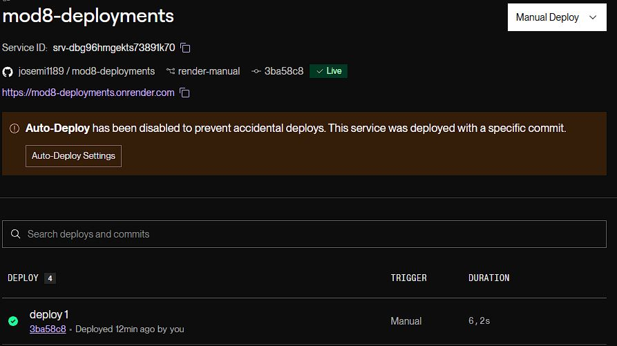

# Módulo 8 - Cloud

## Desplegar en Vercel de forma automática.

[Repositorio GitHub](https://github.com/josemi1189/mod8-deployments)

[Despliegue en Vercel](https://mod8-deployments-af2o.vercel.app/)

1. Generamos nuevo proyecto en Vercel.
2. Ajustamos la configuración de GitHub dando permisos a Vercel para acceder al respositorio de **GitHub** que queremos desplegar. Una vez hecho deberá aparecer en el desplegable.

   

3. Al hacer clic en **Importar** nos aparece la configuración del proyecto donde elegiremos los comandos necesarios para el despliegue según la configuración de nuestra aplicación.

   

4. Hacemos clic en deploy y empezará a ejecutar todos los comandos necesarios para el despliegue.

5. El despliegue se realiza desde la rama principal `main`. Cada vez que se realice una actualización mediante push a esta rama se ejecutará un nuevo despliegue en **Vercel** de forma automática.

6. Podemos comprobar el proceso de despliegue en el apartado `Deployments`.
   

---

## Desplegar en Render de forma manual

[Repositorio GitHub](https://github.com/josemi1189/mod8-deployments)

[Despliegue manual en Render](https://mod8-deployments.onrender.com/)

La aplicación es una SPA de Vite y React Router. No necesita un servidor Node en producción: Render puede publicar directamente los archivos estáticos que genera Vite en `dist`.

1. Crea y publica una rama nueva en GitHub para este despliegue.

2. En Render, crea un servicio **Static Site**, conecta el repositorio y elige esa rama.

3. En los ajustes del servicio, deja **Auto-Deploy** desactivado para que los cambios en la rama no se publiquen automáticamente. Cuando quieras desplegar, usa **Manual Deploy > Deploy latest commit** o eligiendo un commit específico desde **Manuel Deploy > Deploy a specific commit**.

4. En **Redirects/Rewrites**, añade una regla de tipo **Rewrite** con origen `/*` y destino `/index.html`. Así, las rutas gestionadas por React Router también funcionarán al abrirlas directamente o recargar la página.

5. Generamos una build en nuestro código y copiamos solo el contenido de la carpeta `dist` a la rama que utilizamos para el despliegue. Una vez subidos los cambios a **GitHub**, hacemos el deploy desde **Render**.
   
