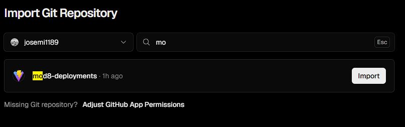
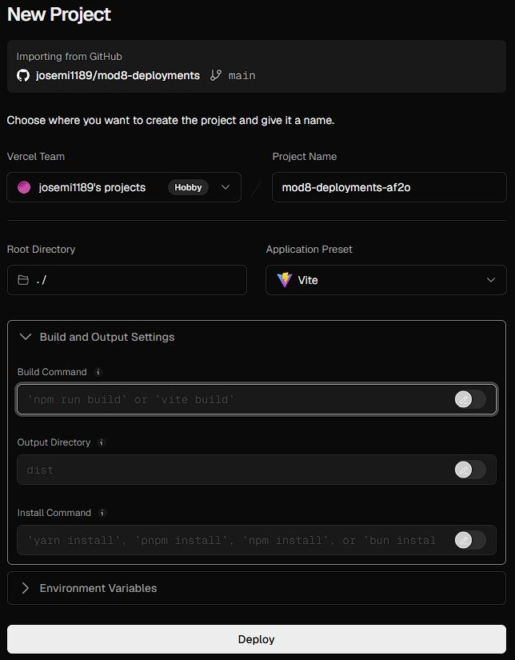
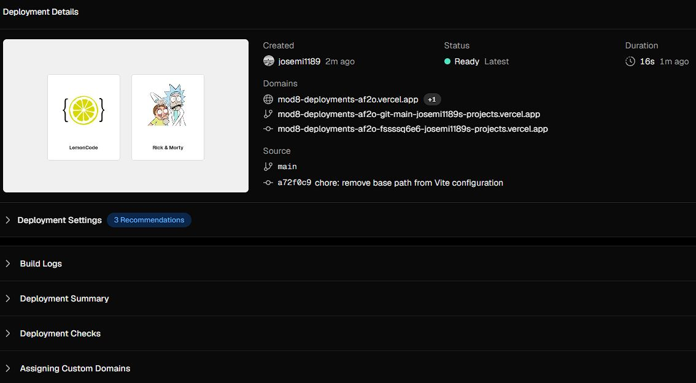

# Módulo 8 - Cloud

## Enlaces

[Repositorio GitHub](https://github.com/josemi1189/mod8-deployments)

[Vercel Deploy](https://mod8-deployments-af2o.vercel.app/)

## Desplegar en Vercel de forma automática.

1. Generamos nuevo proyecto en Vercel.
2. Ajustamos la configuración de GitHub dando permisos a Vercel para acceder al respositorio de **GitHub** que queremos desplegar. Una vez hecho deberá aparecer en el desplegable.

   

3. Al hacer clic en **Importar** nos aparece la configuración del proyecto donde elegiremos los comandos necesarios para el despliegue según la configuración de nuestra aplicación.

   

4. Hacemos clic en deploy y empezará a ejecutar todos los comandos necesarios para el despliegue.

5. El despliegue se realiza desde la rama principal `main`. Cada vez que se realice una actualización mediante push a esta rama se ejecutará un nuevo despliegue en **Vercel** de forma automática.

6. Podemos comprobar el proceso de despliegue en el apartado `Deployments`.
   
